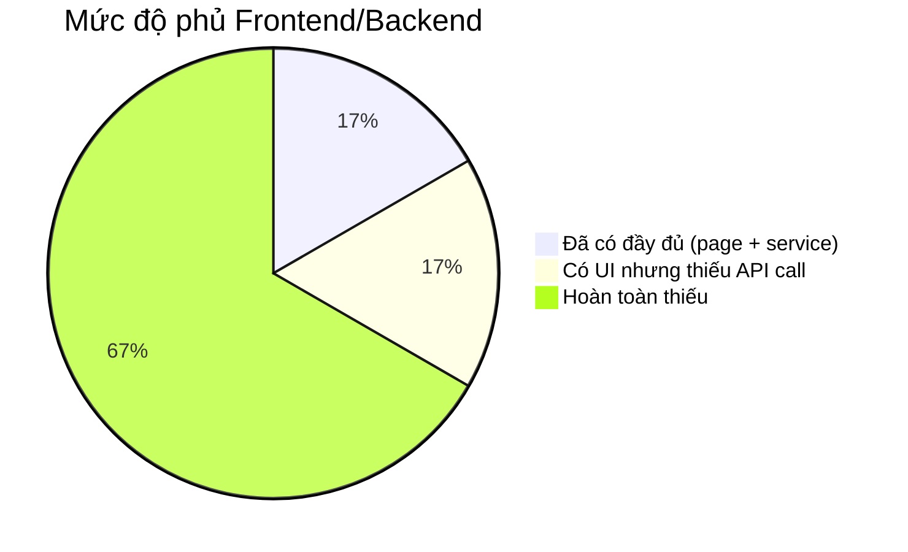

# 🔍 Phân tích độ phủ Frontend so với Backend API

## Tổng quan

| Chỉ số | Backend | Frontend | Trạng thái |
|--------|---------|----------|------------|
| Controllers | 9 | — | — |
| API Endpoints | ~30 | ~6 (được gọi) | ⚠️ **Thiếu nhiều** |
| Trang (Pages) | — | 6 files | ⚠️ **Thiếu nhiều** |
| Services | — | 2 files (`api.ts`, `authService.ts`) | ⚠️ **Thiếu nhiều** |

---

## Chi tiết so sánh theo từng Module

### 1. 🔐 AuthController — `Phần lớn đã có`

| Backend API | Frontend Page/Service | Trạng thái |
|-------------|----------------------|------------|
| `POST /auth/login` | [LoginPage.tsx](file:///c:/Users/ANHVU/LEARNING/DATN/DATN-Project/speed-frontend/src/pages/auth/LoginPage.tsx) + `authService.login()` | ✅ Có |
| `POST /auth/register` | [RegisterPage.tsx](file:///c:/Users/ANHVU/LEARNING/DATN/DATN-Project/speed-frontend/src/pages/auth/RegisterPage.tsx) + `authService.register()` | ✅ Có |
| `GET /auth/profile` | `authService.getProfile()` | ✅ Có (service) |
| `PUT /auth/profile` | Chưa có UI chỉnh sửa profile | ❌ **Thiếu trang** |
| `POST /auth/refresh` | Xử lý tự động trong `api.ts` interceptor | ✅ Có |
| `POST /auth/forgot-password` | `authService.forgotPassword()` (có service, chưa có UI) | ⚠️ **Thiếu trang** |
| `POST /auth/reset-password` | Chưa có | ❌ **Thiếu cả service + trang** |
| `PUT /auth/change-password` | `authService.changePassword()` (có service, chưa có UI) | ⚠️ **Thiếu trang** |
| `POST /auth/logout` | `authService.logout()` + nút trong sidebar | ✅ Có |

---

### 2. 👤 CustomerController — `Hoàn toàn thiếu`

| Backend API | Frontend | Trạng thái |
|-------------|----------|------------|
| `GET /customers/{id}/addresses` | Chưa có | ❌ **Thiếu** |
| `POST /customers/{id}/addresses` | Chưa có | ❌ **Thiếu** |
| `PUT /customers/{id}/addresses/{addressId}` | Chưa có | ❌ **Thiếu** |
| `DELETE /customers/{id}/addresses/{addressId}` | Chưa có | ❌ **Thiếu** |

> [!WARNING]
> **Không có trang quản lý địa chỉ** cho khách hàng. Route `/profile` hiện tại chỉ render lại `CustomerDashboard` — không có UI riêng cho profile/địa chỉ.

---

### 3. 📦 OrderController — `Thiếu phần lớn`

| Backend API | Frontend | Trạng thái |
|-------------|----------|------------|
| `POST /orders` | [CreateOrderPage.tsx](file:///c:/Users/ANHVU/LEARNING/DATN/DATN-Project/speed-frontend/src/pages/customer/CreateOrderPage.tsx) | ✅ Có |
| `GET /orders/{id}` | Chưa có trang chi tiết đơn | ❌ **Thiếu** |
| `GET /orders/code/{orderCode}` | Chưa có | ❌ **Thiếu** |
| `GET /orders/customer/{customerId}` | Chưa có (route `/orders` render lại Dashboard) | ❌ **Thiếu** |
| `PUT /orders/{id}/status` | Chưa có | ❌ **Thiếu** |
| `PUT /orders/{id}/cancel` | Chưa có | ❌ **Thiếu** |

> [!WARNING]
> Route `/orders` trong [App.tsx](file:///c:/Users/ANHVU/LEARNING/DATN/DATN-Project/speed-frontend/src/App.tsx#L29) hiện tại render lại `CustomerDashboard` thay vì trang danh sách đơn hàng riêng biệt.

---

### 4. 🚗 DriverController — `Chỉ có UI cơ bản, thiếu service`

| Backend API | Frontend | Trạng thái |
|-------------|----------|------------|
| `PUT /drivers/{id}/availability` | Có nút toggle trong [DriverDashboard.tsx](file:///c:/Users/ANHVU/LEARNING/DATN/DATN-Project/speed-frontend/src/pages/driver/DriverDashboard.tsx) nhưng **chưa gọi API** | ⚠️ Thiếu service |
| `POST /drivers/{id}/orders/{orderId}/accept` | Có nút "Nhận đơn" nhưng **chưa gọi API** | ⚠️ Thiếu service |
| `POST /drivers/{id}/orders/{orderId}/reject` | Có nút "Từ chối" nhưng **chưa gọi API** | ⚠️ Thiếu service |
| `PUT /drivers/{id}/orders/{orderId}/complete` | Chưa có | ❌ **Thiếu** |
| `GET /drivers/{id}/orders` | Route `/driver/orders` render lại Dashboard | ❌ **Thiếu trang riêng** |
| `GET /drivers/{id}/earnings` | Có hiển thị thu nhập nhưng **dữ liệu hardcode** | ⚠️ Thiếu service |

---

### 5. 🛡️ AdminController — `Chỉ có Dashboard cơ bản`

| Backend API | Frontend | Trạng thái |
|-------------|----------|------------|
| `GET /admin/dashboard` | [AdminDashboard.tsx](file:///c:/Users/ANHVU/LEARNING/DATN/DATN-Project/speed-frontend/src/pages/admin/AdminDashboard.tsx) — **dữ liệu hardcode** | ⚠️ Thiếu service |
| `GET /admin/users` | Route `/admin/users` render lại Dashboard | ❌ **Thiếu trang riêng** |
| `GET /admin/users/{id}` | Chưa có | ❌ **Thiếu** |
| `PUT /admin/users/{id}/toggle-active` | Chưa có | ❌ **Thiếu** |
| `DELETE /admin/users/{id}` | Chưa có | ❌ **Thiếu** |
| `GET /admin/logs` | Chưa có | ❌ **Thiếu** |
| `GET /admin/logs/user/{userId}` | Chưa có | ❌ **Thiếu** |

---

### 6. 🔔 NotificationController — `Hoàn toàn thiếu`

| Backend API | Frontend | Trạng thái |
|-------------|----------|------------|
| `GET /notifications/user/{userId}` | Chưa có | ❌ **Thiếu** |
| `PUT /notifications/{id}/read` | Chưa có | ❌ **Thiếu** |
| `GET /notifications/user/{userId}/unread-count` | Có icon Bell trong header nhưng badge **hardcode** | ⚠️ Thiếu service |
| `POST /notifications` | Chưa có | ❌ **Thiếu** |
| `POST /notifications/order` | Chưa có | ❌ **Thiếu** |

---

### 7. ⭐ ReviewController — `Hoàn toàn thiếu`

| Backend API | Frontend | Trạng thái |
|-------------|----------|------------|
| `POST /reviews` | Chưa có | ❌ **Thiếu** |
| `GET /reviews/order/{orderId}` | Chưa có | ❌ **Thiếu** |
| `GET /reviews/driver/{driverId}` | Chưa có | ❌ **Thiếu** |

---

### 8. 🎟️ VoucherController — `Hoàn toàn thiếu`

| Backend API | Frontend | Trạng thái |
|-------------|----------|------------|
| `GET /vouchers/active` | Chưa có | ❌ **Thiếu** |
| `GET /vouchers/{id}` | Chưa có | ❌ **Thiếu** |
| `POST /vouchers/validate` | Chưa có (CreateOrderPage có field voucherCode nhưng không validate) | ⚠️ **Thiếu** |
| `POST /vouchers` (Admin) | Chưa có | ❌ **Thiếu** |

---

### 9. 💰 WalletController — `Hoàn toàn thiếu`

| Backend API | Frontend | Trạng thái |
|-------------|----------|------------|
| `GET /wallets/driver/{driverId}` | Chưa có | ❌ **Thiếu** |
| `GET /wallets/driver/{driverId}/transactions` | Chưa có | ❌ **Thiếu** |
| `POST /wallets/driver/{driverId}/withdraw` | Chưa có | ❌ **Thiếu** |

---

## 📊 Tổng kết mức độ phủ

| Mức độ | Số endpoint | Chi tiết |
|--------|-------------|----------|
| ✅ Đầy đủ | ~5 | Login, Register, Profile (GET), Refresh Token, Logout |
| ⚠️ Có UI / thiếu service | ~5 | Toggle availability, Accept/Reject order, Dashboard stats, Earnings |
| ❌ Hoàn toàn thiếu | ~20 | Customer addresses, Order list/detail/cancel, Admin users/logs, Notification, Review, Voucher, Wallet |

---

## 🚨 Vấn đề nghiêm trọng

> [!CAUTION]
> **Nhiều route dùng chung 1 component**: Trong [App.tsx](file:///c:/Users/ANHVU/LEARNING/DATN/DATN-Project/speed-frontend/src/App.tsx), các route `/orders`, `/profile`, `/admin/orders`, `/admin/users`, `/driver/orders`, `/driver/profile` đều render lại component Dashboard tương ứng thay vì trang riêng biệt.

> [!IMPORTANT]
> **Dữ liệu hardcode**: Tất cả các trang Dashboard đều sử dụng dữ liệu giả (hardcode), không gọi API backend thực sự.

---

## 📋 Danh sách các trang/service cần bổ sung

### Trang cần tạo mới (Pages)
1. **`/profile`** → `ProfilePage.tsx` — Xem/chỉnh sửa thông tin cá nhân + đổi mật khẩu
2. **`/profile/addresses`** → `AddressPage.tsx` — Quản lý địa chỉ (CRUD)
3. **`/orders`** → `OrderListPage.tsx` — Danh sách đơn hàng khách hàng (phân trang)
4. **`/orders/:id`** → `OrderDetailPage.tsx` — Chi tiết + hủy + đánh giá đơn hàng
5. **`/forgot-password`** → `ForgotPasswordPage.tsx` — Quên mật khẩu
6. **`/reset-password`** → `ResetPasswordPage.tsx` — Đặt lại mật khẩu bằng OTP
7. **`/driver/orders`** → `DriverOrdersPage.tsx` — Lịch sử giao hàng tài xế
8. **`/driver/wallet`** → `DriverWalletPage.tsx` — Ví + lịch sử giao dịch + rút tiền
9. **`/driver/profile`** → `DriverProfilePage.tsx` — Thông tin + đánh giá tài xế
10. **`/admin/users`** → `AdminUsersPage.tsx` — Quản lý người dùng (list, toggle, delete)
11. **`/admin/users/:id`** → `AdminUserDetailPage.tsx` — Chi tiết người dùng
12. **`/admin/orders`** → `AdminOrdersPage.tsx` — Quản lý đơn hàng (tất cả)
13. **`/admin/logs`** → `AdminLogsPage.tsx` — Audit logs
14. **`/admin/vouchers`** → `AdminVouchersPage.tsx` — Quản lý voucher
15. **Notification panel/page** → Trang hoặc dropdown thông báo

### Service cần tạo mới
1. **`orderService.ts`** — CRUD orders
2. **`driverService.ts`** — Toggle availability, accept/reject/complete, earnings
3. **`adminService.ts`** — Dashboard stats, users CRUD, logs
4. **`customerService.ts`** — Addresses CRUD
5. **`notificationService.ts`** — Notifications
6. **`reviewService.ts`** — Reviews
7. **`voucherService.ts`** — Vouchers
8. **`walletService.ts`** — Wallet + transactions
