# 📋 Báo cáo tổng hợp: Tất cả trang giao diện – Có sẵn & Còn thiếu

**Dự án:** Speed Delivery  
**Ngày:** 08/09/2026  
**Backend:** 9 Controllers · 18 Services · 16 Entities  
**Frontend hiện tại:** 6 trang · 2 component dùng chung  
**Tổng trang cần có (theo backend):** 23 trang  

---

## PHẦN A — CÁC TRANG ĐÃ CÓ SẴN (6 trang)

---

### Trang 1: 🔐 Đăng nhập (LoginPage)

| | |
|---|---|
| **File** | [LoginPage.tsx](file:///c:/Users/ANHVU/LEARNING/DATN/DATN-Project/speed-frontend/src/pages/auth/LoginPage.tsx) |
| **Route** | `/login` |
| **Backend API** | `POST /auth/login` |
| **Tích hợp API** | ✅ Đã kết nối |

**Các nút / chức năng trên trang:**

| STT | Tên nút / chức năng | Loại | Hoạt động |
|:---:|----------------------|------|-----------|
| 1 | Input Email | Input field | Nhập email đăng nhập |
| 2 | Input Mật khẩu | Input field | Nhập mật khẩu, có nút ẩn/hiện (Eye icon) |
| 3 | Checkbox "Ghi nhớ đăng nhập" | Checkbox | Ghi nhớ phiên đăng nhập |
| 4 | Link "Quên mật khẩu?" | Link | Dẫn đến `/forgot-password` ⚠️ trang chưa có |
| 5 | **Nút "Đăng nhập"** | Button submit | Gọi API `POST /auth/login`, redirect theo role |
| 6 | Link "Đăng ký ngay" | Link | Dẫn đến `/register` |

---

### Trang 2: 📝 Đăng ký (RegisterPage)

| | |
|---|---|
| **File** | [RegisterPage.tsx](file:///c:/Users/ANHVU/LEARNING/DATN/DATN-Project/speed-frontend/src/pages/auth/RegisterPage.tsx) |
| **Route** | `/register` |
| **Backend API** | `POST /auth/register` |
| **Tích hợp API** | ✅ Đã kết nối |

**Các nút / chức năng trên trang:**

| STT | Tên nút / chức năng | Loại | Hoạt động |
|:---:|----------------------|------|-----------|
| 1 | Tab "Khách hàng" / "Tài xế" | Tab selector | Chọn vai trò đăng ký (CUSTOMER / DRIVER) |
| 2 | Input Họ và tên | Input field | Nhập họ tên |
| 3 | Input Email | Input field | Nhập email |
| 4 | Input Số điện thoại | Input field | Nhập SĐT |
| 5 | Input Mật khẩu | Input field | Nhập mật khẩu (tối thiểu 6 ký tự) |
| 6 | **Nút "Đăng ký"** | Button submit | Gọi API `POST /auth/register`, redirect về trang chủ |
| 7 | Link "Đăng nhập" | Link | Dẫn đến `/login` |

---

### Trang 3: 🏠 Dashboard Khách hàng (CustomerDashboard)

| | |
|---|---|
| **File** | [CustomerDashboard.tsx](file:///c:/Users/ANHVU/LEARNING/DATN/DATN-Project/speed-frontend/src/pages/customer/CustomerDashboard.tsx) |
| **Route** | `/` · `/orders` · `/profile` (⚠️ 3 route dùng chung) |
| **Backend API** | `GET /orders/customer/{id}` · `GET /auth/profile` |
| **Tích hợp API** | ❌ Chưa kết nối — dữ liệu hardcode |

**Các nút / chức năng trên trang:**

| STT | Tên nút / chức năng | Loại | Hoạt động |
|:---:|----------------------|------|-----------|
| 1 | Lời chào người dùng | Text hiển thị | Lấy tên từ Redux store |
| 2 | Card "Tổng đơn hàng" | Stat card | Hiển thị số 24 ⚠️ hardcode |
| 3 | Card "Đang giao" | Stat card | Hiển thị số 3 ⚠️ hardcode |
| 4 | Card "Hoàn thành" | Stat card | Hiển thị số 18 ⚠️ hardcode |
| 5 | Card "Chờ xử lý" | Stat card | Hiển thị số 3 ⚠️ hardcode |
| 6 | Danh sách đơn hàng gần đây (3 mục) | List | Hiển thị mã đơn, trạng thái, địa chỉ, giá ⚠️ hardcode |
| 7 | Link "Xem tất cả" | Link | Dẫn đến `/orders` (cùng component) |
| 8 | **Nút "Tạo đơn mới"** | Button/Link | Dẫn đến `/orders/new` |

---

### Trang 4: 📦 Tạo đơn hàng mới (CreateOrderPage)

| | |
|---|---|
| **File** | [CreateOrderPage.tsx](file:///c:/Users/ANHVU/LEARNING/DATN/DATN-Project/speed-frontend/src/pages/customer/CreateOrderPage.tsx) |
| **Route** | `/orders/new` |
| **Backend API** | `POST /orders` · `POST /vouchers/validate` |
| **Tích hợp API** | ❌ Chưa kết nối — chỉ hiện alert demo |

**Các nút / chức năng trên trang (Multi-step wizard – 3 bước):**

| STT | Tên nút / chức năng | Bước | Loại | Hoạt động |
|:---:|----------------------|:----:|------|-----------|
| 1 | Stepper (thanh tiến trình) | Tất cả | UI | Hiển thị 3 bước: Địa chỉ → Gói hàng → Xác nhận |
| 2 | Input Địa chỉ lấy hàng | 1 | Input | Nhập địa chỉ pickup |
| 3 | Input Tên người gửi | 1 | Input | Nhập tên liên hệ gửi |
| 4 | Input SĐT người gửi | 1 | Input | Nhập SĐT liên hệ gửi |
| 5 | Input Địa chỉ giao hàng | 1 | Input | Nhập địa chỉ delivery |
| 6 | Input Tên người nhận | 1 | Input | Nhập tên liên hệ nhận |
| 7 | Input SĐT người nhận | 1 | Input | Nhập SĐT liên hệ nhận |
| 8 | **Nút "Tiếp tục" (Bước 1→2)** | 1 | Button | Chuyển sang bước 2 |
| 9 | Input Mô tả hàng hóa | 2 | Input | Nhập mô tả gói hàng |
| 10 | Input Khối lượng (kg) | 2 | Input number | Nhập trọng lượng |
| 11 | Textarea Ghi chú tài xế | 2 | Textarea | Ghi chú cho tài xế |
| 12 | Chọn "Tiêu chuẩn" / "Hỏa tốc" | 2 | Toggle button | Chọn loại giao hàng (STANDARD/EXPRESS) |
| 13 | Chọn Thanh toán (Tiền mặt / Ví / CK) | 2 | Toggle button | Chọn phương thức thanh toán |
| 14 | Input Mã giảm giá | 2 | Input | Nhập voucher code ⚠️ chưa validate |
| 15 | **Nút "Quay lại" (2→1)** | 2 | Button | Quay về bước 1 |
| 16 | **Nút "Tiếp tục" (2→3)** | 2 | Button | Chuyển sang bước 3 |
| 17 | Tổng hợp thông tin xác nhận | 3 | Display | Hiển thị lại tất cả thông tin đã nhập |
| 18 | Tổng tiền dự kiến | 3 | Display | Hiển thị 35,000₫ ⚠️ hardcode |
| 19 | **Nút "Quay lại" (3→2)** | 3 | Button | Quay về bước 2 |
| 20 | **Nút "Đặt đơn"** | 3 | Button submit | ⚠️ Chỉ `alert()`, chưa gọi API |

---

### Trang 5: 🛡️ Dashboard Admin (AdminDashboard)

| | |
|---|---|
| **File** | [AdminDashboard.tsx](file:///c:/Users/ANHVU/LEARNING/DATN/DATN-Project/speed-frontend/src/pages/admin/AdminDashboard.tsx) |
| **Route** | `/admin` · `/admin/orders` · `/admin/users` (⚠️ 3 route dùng chung) |
| **Backend API** | `GET /admin/dashboard` |
| **Tích hợp API** | ❌ Chưa kết nối — dữ liệu hardcode |

**Các nút / chức năng trên trang:**

| STT | Tên nút / chức năng | Loại | Hoạt động |
|:---:|----------------------|------|-----------|
| 1 | Card "Tổng đơn hàng" (1,247) | Stat card | Hiển thị + % tăng trưởng ⚠️ hardcode |
| 2 | Card "Khách hàng" (856) | Stat card | Hiển thị + % tăng trưởng ⚠️ hardcode |
| 3 | Card "Tài xế" (124) | Stat card | Hiển thị + % tăng trưởng ⚠️ hardcode |
| 4 | Card "Doanh thu" (125.6M) | Stat card | Hiển thị + % tăng trưởng ⚠️ hardcode |
| 5 | Mục "Chờ xử lý" (23) | Stat + Progress bar | ⚠️ hardcode |
| 6 | Mục "Đang giao" (45) | Stat + Progress bar | ⚠️ hardcode |
| 7 | Mục "Hoàn thành" (1150) | Stat + Progress bar | ⚠️ hardcode |
| 8 | Mục "Đã hủy" (29) | Stat + Progress bar | ⚠️ hardcode |

> [!NOTE]
> Trang chỉ có hiển thị thống kê, **không có nút hành động** nào (không filter, không search, không quản lý).

---

### Trang 6: 🚗 Dashboard Tài xế (DriverDashboard)

| | |
|---|---|
| **File** | [DriverDashboard.tsx](file:///c:/Users/ANHVU/LEARNING/DATN/DATN-Project/speed-frontend/src/pages/driver/DriverDashboard.tsx) |
| **Route** | `/driver` · `/driver/orders` · `/driver/profile` (⚠️ 3 route dùng chung) |
| **Backend API** | `PUT /drivers/{id}/availability` · `POST /drivers/{id}/orders/{orderId}/accept` · `POST /drivers/{id}/orders/{orderId}/reject` · `GET /drivers/{id}/earnings` |
| **Tích hợp API** | ❌ Chưa kết nối — tất cả chưa gọi API |

**Các nút / chức năng trên trang:**

| STT | Tên nút / chức năng | Loại | Hoạt động |
|:---:|----------------------|------|-----------|
| 1 | Card "Thu nhập hôm nay" (320,000₫) | Stat card | ⚠️ hardcode |
| 2 | Card "Đơn đã giao" (8) | Stat card | ⚠️ hardcode |
| 3 | Card "Đánh giá" (4.8) | Stat card | ⚠️ hardcode |
| 4 | Card "Quãng đường" (34 km) | Stat card | ⚠️ hardcode |
| 5 | **Nút "Đang nhận đơn / Offline"** | Toggle button | Chuyển trạng thái online/offline ⚠️ chỉ state local, chưa gọi API |
| 6 | Danh sách đơn hàng mới (2 mục) | List | Hiển thị khi online ⚠️ hardcode |
| 7 | **Nút "Nhận đơn"** | Button (mỗi đơn) | ⚠️ Chưa gọi API `accept` |
| 8 | **Nút "Từ chối"** | Button (mỗi đơn) | ⚠️ Chưa gọi API `reject` |

---

### Component dùng chung: MainLayout

| | |
|---|---|
| **File** | [MainLayout.tsx](file:///c:/Users/ANHVU/LEARNING/DATN/DATN-Project/speed-frontend/src/components/layout/MainLayout.tsx) |

| STT | Tên nút / chức năng | Hoạt động |
|:---:|----------------------|-----------|
| 1 | Logo "Speed" | Sidebar brand |
| 2 | Menu điều hướng theo role | Customer: 4 mục · Driver: 3 mục · Admin: 3 mục |
| 3 | Thông tin user (tên + email) | Hiển thị từ Redux store |
| 4 | **Nút "Đăng xuất"** | Gọi `logout()`, redirect `/login` ✅ |
| 5 | **Nút hamburger menu** (mobile) | Mở/đóng sidebar trên mobile |
| 6 | **Icon Thông báo (🔔)** | Badge đỏ ⚠️ hardcode, chưa gọi API |
| 7 | Avatar user | Hiển thị chữ cái đầu tên |

---

## PHẦN B — CÁC TRANG CÒN THIẾU (17 trang)

> Dựa trên phân tích 9 Backend Controllers + 18 Backend Services + 16 Entities

---

### Trang 7: 🔑 Quên mật khẩu (ForgotPasswordPage) — `THIẾU`

| | |
|---|---|
| **Route dự kiến** | `/forgot-password` |
| **Backend API** | `POST /auth/forgot-password` |
| **Service FE có sẵn** | `authService.forgotPassword()` ✅ |

**Các nút / chức năng cần có:**

| STT | Tên nút / chức năng | Loại | Hoạt động |
|:---:|----------------------|------|-----------|
| 1 | Input Email | Input field | Nhập email cần khôi phục |
| 2 | **Nút "Gửi mã OTP"** | Button submit | Gọi API gửi OTP qua email |
| 3 | Link "Quay lại Đăng nhập" | Link | Dẫn về `/login` |

---

### Trang 8: 🔓 Đặt lại mật khẩu (ResetPasswordPage) — `THIẾU`

| | |
|---|---|
| **Route dự kiến** | `/reset-password` |
| **Backend API** | `POST /auth/reset-password` |

**Các nút / chức năng cần có:**

| STT | Tên nút / chức năng | Loại | Hoạt động |
|:---:|----------------------|------|-----------|
| 1 | Input Email | Input field | Email đã yêu cầu OTP |
| 2 | Input Mã OTP | Input field | Nhập mã OTP nhận được |
| 3 | Input Mật khẩu mới | Input field | Nhập mật khẩu mới |
| 4 | Input Xác nhận mật khẩu | Input field | Xác nhận mật khẩu mới |
| 5 | **Nút "Đặt lại mật khẩu"** | Button submit | Gọi API reset password |

---

### Trang 9: 👤 Hồ sơ cá nhân (ProfilePage) — `THIẾU`

| | |
|---|---|
| **Route dự kiến** | `/profile` (thay thế render CustomerDashboard hiện tại) |
| **Backend API** | `GET /auth/profile` · `PUT /auth/profile` · `PUT /auth/change-password` |

**Các nút / chức năng cần có:**

| STT | Tên nút / chức năng | Loại | Hoạt động |
|:---:|----------------------|------|-----------|
| 1 | Hiển thị Họ tên | Display / Input | Xem + sửa |
| 2 | Hiển thị Email | Display | Chỉ xem |
| 3 | Hiển thị Số điện thoại | Display / Input | Xem + sửa |
| 4 | Hiển thị Avatar | Image | Xem + upload ảnh (FileStorageService) |
| 5 | Trạng thái xác minh | Badge | Đã xác minh / Chưa xác minh |
| 6 | **Nút "Cập nhật hồ sơ"** | Button submit | Gọi API `PUT /auth/profile` |
| 7 | Input Mật khẩu hiện tại | Input field | Phần đổi mật khẩu |
| 8 | Input Mật khẩu mới | Input field | Phần đổi mật khẩu |
| 9 | **Nút "Đổi mật khẩu"** | Button submit | Gọi API `PUT /auth/change-password` |

---

### Trang 10: 📍 Quản lý địa chỉ (AddressPage) — `THIẾU`

| | |
|---|---|
| **Route dự kiến** | `/profile/addresses` hoặc tab trong ProfilePage |
| **Backend API** | `GET /customers/{id}/addresses` · `POST` · `PUT` · `DELETE` |

**Các nút / chức năng cần có:**

| STT | Tên nút / chức năng | Loại | Hoạt động |
|:---:|----------------------|------|-----------|
| 1 | Danh sách địa chỉ đã lưu | List | Hiển thị tất cả địa chỉ |
| 2 | Badge "Mặc định" | Badge | Đánh dấu địa chỉ mặc định |
| 3 | **Nút "Thêm địa chỉ"** | Button + Modal | Mở form thêm địa chỉ mới |
| 4 | Input Tên địa chỉ | Input | Nhập label (Nhà, Công ty...) |
| 5 | Input Địa chỉ chi tiết | Input | Nhập địa chỉ đầy đủ |
| 6 | Input Số điện thoại | Input | Nhập SĐT liên hệ |
| 7 | **Nút "Sửa"** (mỗi địa chỉ) | Button | Gọi API `PUT` cập nhật |
| 8 | **Nút "Xóa"** (mỗi địa chỉ) | Button | Gọi API `DELETE` xóa địa chỉ |
| 9 | **Nút "Đặt mặc định"** (mỗi địa chỉ) | Button | Gọi `setDefaultAddress` |

---

### Trang 11: 📋 Danh sách đơn hàng – Khách hàng (OrderListPage) — `THIẾU`

| | |
|---|---|
| **Route dự kiến** | `/orders` (thay thế render CustomerDashboard hiện tại) |
| **Backend API** | `GET /orders/customer/{id}` |

**Các nút / chức năng cần có:**

| STT | Tên nút / chức năng | Loại | Hoạt động |
|:---:|----------------------|------|-----------|
| 1 | Bảng/Danh sách đơn hàng | Table/List | Mã đơn, trạng thái, ngày tạo, giá, tài xế |
| 2 | Lọc theo trạng thái | Filter/Tabs | PENDING / IN_TRANSIT / DELIVERED / CANCELLED |
| 3 | Tìm kiếm theo mã đơn | Search input | Gọi API `GET /orders/code/{code}` |
| 4 | Phân trang | Pagination | Trang trước / sau |
| 5 | **Nút "Xem chi tiết"** (mỗi đơn) | Button/Link | Dẫn đến `/orders/:id` |
| 6 | **Nút "Tạo đơn mới"** | Button | Dẫn đến `/orders/new` |

---

### Trang 12: 📄 Chi tiết đơn hàng (OrderDetailPage) — `THIẾU`

| | |
|---|---|
| **Route dự kiến** | `/orders/:id` |
| **Backend API** | `GET /orders/{id}` · `PUT /orders/{id}/cancel` · `POST /reviews` · `GET /reviews/order/{id}` |

**Các nút / chức năng cần có:**

| STT | Tên nút / chức năng | Loại | Hoạt động |
|:---:|----------------------|------|-----------|
| 1 | Mã đơn hàng + Trạng thái (badge) | Display | Hiển thị orderCode + status |
| 2 | Timeline trạng thái | Timeline UI | PENDING → CONFIRMED → ASSIGNED → PICKING_UP → IN_TRANSIT → DELIVERED |
| 3 | Thông tin lấy hàng | Display | Địa chỉ, tên, SĐT người gửi |
| 4 | Thông tin giao hàng | Display | Địa chỉ, tên, SĐT người nhận |
| 5 | Thông tin gói hàng | Display | Mô tả, trọng lượng |
| 6 | Thông tin tài xế | Display | Tên, SĐT tài xế (nếu đã gán) |
| 7 | Chi tiết giá | Display | Tổng giá, giảm giá, thanh toán |
| 8 | **Nút "Hủy đơn"** | Button (danger) | Gọi API `PUT /orders/{id}/cancel` (chỉ khi PENDING/CONFIRMED) |
| 9 | Input Lý do hủy | Input/Modal | Nhập lý do hủy |
| 10 | Form đánh giá (1-5 sao) | Star rating | Chọn số sao (chỉ khi DELIVERED) |
| 11 | Input Bình luận | Textarea | Nhập bình luận đánh giá |
| 12 | **Nút "Gửi đánh giá"** | Button submit | Gọi API `POST /reviews` |
| 13 | Hiển thị đánh giá đã gửi | Display | Gọi API `GET /reviews/order/{id}` |

---

### Trang 13: 🔔 Thông báo (NotificationPage) — `THIẾU`

| | |
|---|---|
| **Route dự kiến** | `/notifications` hoặc dropdown panel |
| **Backend API** | `GET /notifications/user/{id}` · `PUT /notifications/{id}/read` · `GET .../unread-count` |

**Các nút / chức năng cần có:**

| STT | Tên nút / chức năng | Loại | Hoạt động |
|:---:|----------------------|------|-----------|
| 1 | Danh sách thông báo | List | Tiêu đề, nội dung, thời gian, trạng thái đọc |
| 2 | Badge số chưa đọc | Badge | Gọi API `unread-count` |
| 3 | **Nút "Đánh dấu đã đọc"** (mỗi thông báo) | Button | Gọi API `PUT /notifications/{id}/read` |
| 4 | **Nút "Đánh dấu tất cả đã đọc"** | Button | Gọi API cho tất cả |
| 5 | Phân trang | Pagination | Trang trước / sau |

---

### Trang 14: 📋 Lịch sử giao hàng – Tài xế (DriverOrdersPage) — `THIẾU`

| | |
|---|---|
| **Route dự kiến** | `/driver/orders` (thay thế render DriverDashboard) |
| **Backend API** | `GET /drivers/{id}/orders` · `PUT /drivers/{id}/orders/{orderId}/complete` |

**Các nút / chức năng cần có:**

| STT | Tên nút / chức năng | Loại | Hoạt động |
|:---:|----------------------|------|-----------|
| 1 | Bảng/Danh sách đơn đã giao | Table/List | Mã đơn, khách hàng, địa chỉ, giá, trạng thái |
| 2 | Lọc theo trạng thái | Filter/Tabs | Đang giao / Hoàn thành / Đã hủy |
| 3 | Phân trang | Pagination | Trang trước / sau |
| 4 | **Nút "Xem chi tiết"** (mỗi đơn) | Button | Mở chi tiết đơn |
| 5 | **Nút "Hoàn thành giao hàng"** | Button | Gọi API `PUT .../complete` (khi IN_TRANSIT) |

---

### Trang 15: 💰 Ví tài xế (DriverWalletPage) — `THIẾU`

| | |
|---|---|
| **Route dự kiến** | `/driver/wallet` |
| **Backend API** | `GET /wallets/driver/{id}` · `GET .../transactions` · `POST .../withdraw` |

**Các nút / chức năng cần có:**

| STT | Tên nút / chức năng | Loại | Hoạt động |
|:---:|----------------------|------|-----------|
| 1 | Hiển thị số dư ví | Display (card lớn) | Gọi API `GET /wallets/driver/{id}` |
| 2 | Lịch sử giao dịch | Table/List | Loại giao dịch, số tiền, thời gian, mã đơn |
| 3 | Phân trang giao dịch | Pagination | Trang trước / sau |
| 4 | Input Số tiền rút | Input number | Nhập số tiền cần rút |
| 5 | **Nút "Rút tiền"** | Button submit | Gọi API `POST .../withdraw` |

---

### Trang 16: 👤 Hồ sơ tài xế (DriverProfilePage) — `THIẾU`

| | |
|---|---|
| **Route dự kiến** | `/driver/profile` (thay thế render DriverDashboard) |
| **Backend API** | `GET /auth/profile` · `PUT /auth/profile` · `GET /reviews/driver/{id}` · `GET /drivers/{id}/earnings` |

**Các nút / chức năng cần có:**

| STT | Tên nút / chức năng | Loại | Hoạt động |
|:---:|----------------------|------|-----------|
| 1 | Hiển thị thông tin cá nhân | Display | Tên, email, SĐT, avatar |
| 2 | **Nút "Cập nhật hồ sơ"** | Button | Gọi API `PUT /auth/profile` |
| 3 | Hiển thị tổng thu nhập | Display | Gọi API `GET /drivers/{id}/earnings` |
| 4 | Danh sách đánh giá từ khách | List | Gọi API `GET /reviews/driver/{id}` |
| 5 | Điểm đánh giá trung bình | Display | Tính trung bình từ reviews |
| 6 | **Nút "Đổi mật khẩu"** | Button | Gọi API `PUT /auth/change-password` |

---

### Trang 17: 👥 Quản lý người dùng – Admin (AdminUsersPage) — `THIẾU`

| | |
|---|---|
| **Route dự kiến** | `/admin/users` (thay thế render AdminDashboard) |
| **Backend API** | `GET /admin/users` · `PUT /admin/users/{id}/toggle-active` · `DELETE /admin/users/{id}` |

**Các nút / chức năng cần có:**

| STT | Tên nút / chức năng | Loại | Hoạt động |
|:---:|----------------------|------|-----------|
| 1 | Bảng danh sách người dùng | Table | ID, Tên, Email, SĐT, Role, Trạng thái, Ngày tạo |
| 2 | Tìm kiếm | Search input | Tìm theo tên/email |
| 3 | Lọc theo Role | Filter | CUSTOMER / DRIVER / ADMIN |
| 4 | Phân trang | Pagination | Trang trước / sau |
| 5 | **Nút "Xem chi tiết"** (mỗi user) | Button/Link | Dẫn đến `/admin/users/:id` |
| 6 | **Nút "Kích hoạt / Vô hiệu hóa"** (mỗi user) | Toggle button | Gọi API `PUT .../toggle-active` |
| 7 | **Nút "Xóa"** (mỗi user) | Button (danger) | Gọi API `DELETE /admin/users/{id}` + confirm |

---

### Trang 18: 👤 Chi tiết người dùng – Admin (AdminUserDetailPage) — `THIẾU`

| | |
|---|---|
| **Route dự kiến** | `/admin/users/:id` |
| **Backend API** | `GET /admin/users/{id}` · `GET /admin/logs/user/{id}` |

**Các nút / chức năng cần có:**

| STT | Tên nút / chức năng | Loại | Hoạt động |
|:---:|----------------------|------|-----------|
| 1 | Thông tin chi tiết user | Display | Tên, email, SĐT, role, trạng thái, ngày tạo |
| 2 | Lịch sử hoạt động (audit logs) | Table | Hành động, đối tượng, thời gian |
| 3 | **Nút "Kích hoạt / Vô hiệu hóa"** | Toggle | Gọi API toggle-active |
| 4 | **Nút "Xóa người dùng"** | Button (danger) | Gọi API delete + confirm |
| 5 | **Nút "Quay lại"** | Button/Link | Dẫn về `/admin/users` |

---

### Trang 19: 📦 Quản lý đơn hàng – Admin (AdminOrdersPage) — `THIẾU`

| | |
|---|---|
| **Route dự kiến** | `/admin/orders` (thay thế render AdminDashboard) |
| **Backend API** | `GET /orders/customer/{id}` · `GET /orders/{id}` · `PUT /orders/{id}/status` · `PUT /orders/{id}/cancel` |

**Các nút / chức năng cần có:**

| STT | Tên nút / chức năng | Loại | Hoạt động |
|:---:|----------------------|------|-----------|
| 1 | Bảng danh sách tất cả đơn hàng | Table | Mã đơn, khách, tài xế, trạng thái, giá, ngày |
| 2 | Lọc theo trạng thái | Filter/Tabs | 7 trạng thái (PENDING → CANCELLED) |
| 3 | Tìm kiếm theo mã đơn | Search | Gọi API `GET /orders/code/{code}` |
| 4 | Phân trang | Pagination | Trang trước / sau |
| 5 | **Nút "Xem chi tiết"** (mỗi đơn) | Button | Mở chi tiết đơn |
| 6 | **Nút "Cập nhật trạng thái"** | Dropdown/Button | Gọi API `PUT /orders/{id}/status` |
| 7 | **Nút "Hủy đơn"** | Button (danger) | Gọi API `PUT /orders/{id}/cancel` |
| 8 | **Nút "Gán tài xế"** | Button/Modal | Gọi API `assignDriver()` |

---

### Trang 20: 📜 Audit Logs – Admin (AdminLogsPage) — `THIẾU`

| | |
|---|---|
| **Route dự kiến** | `/admin/logs` |
| **Backend API** | `GET /admin/logs` · `GET /admin/logs/user/{userId}` |

**Các nút / chức năng cần có:**

| STT | Tên nút / chức năng | Loại | Hoạt động |
|:---:|----------------------|------|-----------|
| 1 | Bảng danh sách audit logs | Table | User, Action, Entity, Entity ID, Timestamp |
| 2 | Lọc theo User | Filter/Select | Chọn user để xem logs |
| 3 | Lọc theo Action | Filter | TOGGLE_AVAILABILITY, CREATE_ORDER... |
| 4 | Phân trang | Pagination | Trang trước / sau |

---

### Trang 21: 🎟️ Quản lý Voucher – Admin (AdminVouchersPage) — `THIẾU`

| | |
|---|---|
| **Route dự kiến** | `/admin/vouchers` |
| **Backend API** | `GET /vouchers/active` · `GET /vouchers/{id}` · `POST /vouchers` |

**Các nút / chức năng cần có:**

| STT | Tên nút / chức năng | Loại | Hoạt động |
|:---:|----------------------|------|-----------|
| 1 | Bảng danh sách voucher | Table | Mã, mô tả, loại giảm, giá trị, ngày, trạng thái, đã dùng |
| 2 | **Nút "Tạo voucher mới"** | Button + Modal/Form | Mở form tạo voucher |
| 3 | Input Mã voucher | Input | Nhập mã voucher |
| 4 | Input Mô tả | Input | Nhập mô tả |
| 5 | Select Loại giảm giá | Select | PERCENTAGE / FIXED_AMOUNT |
| 6 | Input Giá trị giảm | Input number | Nhập giá trị % hoặc số tiền |
| 7 | Input Giảm tối đa | Input number | Nhập giới hạn giảm |
| 8 | Input Đơn tối thiểu | Input number | Nhập giá trị đơn tối thiểu |
| 9 | Input Giới hạn sử dụng | Input number | Số lần dùng tối đa |
| 10 | Input Ngày bắt đầu / kết thúc | Date picker | Chọn thời hạn hiệu lực |
| 11 | **Nút "Lưu voucher"** | Button submit | Gọi API `POST /vouchers` |
| 12 | **Nút "Xem chi tiết"** (mỗi voucher) | Button | Gọi API `GET /vouchers/{id}` |

---

### Trang 22: 🎫 Danh sách Voucher – Khách hàng (VoucherListPage) — `THIẾU`

| | |
|---|---|
| **Route dự kiến** | `/vouchers` |
| **Backend API** | `GET /vouchers/active` · `POST /vouchers/validate` |

**Các nút / chức năng cần có:**

| STT | Tên nút / chức năng | Loại | Hoạt động |
|:---:|----------------------|------|-----------|
| 1 | Danh sách voucher đang hoạt động | Card list | Mã, mô tả, giá trị giảm, điều kiện, hạn dùng |
| 2 | Input Nhập mã voucher | Input | Kiểm tra voucher thủ công |
| 3 | **Nút "Kiểm tra mã"** | Button | Gọi API `POST /vouchers/validate` |
| 4 | **Nút "Sao chép mã"** (mỗi voucher) | Button | Copy mã vào clipboard |

---

### Trang 23: ⭐ Danh sách đánh giá – Tài xế (DriverReviewsPage) — `THIẾU`

| | |
|---|---|
| **Route dự kiến** | `/driver/reviews` hoặc tab trong DriverProfilePage |
| **Backend API** | `GET /reviews/driver/{driverId}` |

**Các nút / chức năng cần có:**

| STT | Tên nút / chức năng | Loại | Hoạt động |
|:---:|----------------------|------|-----------|
| 1 | Điểm đánh giá trung bình | Display (card lớn) | Tính từ tất cả reviews |
| 2 | Phân bố số sao (5/4/3/2/1) | Bar chart | Hiển thị % mỗi mức sao |
| 3 | Danh sách đánh giá | List | Tên khách, số sao, bình luận, ngày |
| 4 | Phân trang | Pagination | Trang trước / sau |

---

## PHẦN C — BẢNG TỔNG HỢP

### Tổng số trang theo role

| Role | Trang đã có | Trang còn thiếu | Tổng cần có |
|------|:-----------:|:----------------:|:-----------:|
| **Public (Auth)** | 2 (Login, Register) | 2 (Forgot, Reset) | **4** |
| **Khách hàng** | 2 (Dashboard, CreateOrder) | 4 (Profile, Address, OrderList, OrderDetail, Vouchers) | **7** |
| **Tài xế** | 1 (Dashboard) | 4 (Orders, Wallet, Profile, Reviews) | **5** |
| **Admin** | 1 (Dashboard) | 4 (Users, UserDetail, Orders, Logs, Vouchers) | **5** |
| **Dùng chung** | — | 1 (Notification) | **1** |
| **Tổng** | **6** | **17** | **23** |

### Tổng số nút chức năng

| Phân loại | Số nút/chức năng |
|-----------|:----------------:|
| Trang đã có (hoạt động) | ~55 |
| Trang đã có nhưng chưa gọi API | ~12 |
| Trang còn thiếu (cần xây dựng) | ~95 |
| **Tổng dự kiến toàn hệ thống** | **~150** |

---

## 🗺️ Sơ đồ Sitemap đầy đủ

```mermaid
graph TD
    ROOT["Speed Delivery"] --> AUTH["🔐 Xác thực"]
    ROOT --> CUST["👤 Khách hàng"]
    ROOT --> DRV["🚗 Tài xế"]
    ROOT --> ADM["🛡️ Admin"]
    ROOT --> SHARED["🔗 Dùng chung"]

    AUTH --> A1["✅ /login - Đăng nhập"]
    AUTH --> A2["✅ /register - Đăng ký"]
    AUTH --> A3["❌ /forgot-password - Quên MK"]
    AUTH --> A4["❌ /reset-password - Đặt lại MK"]

    CUST --> C1["✅ / - Dashboard"]
    CUST --> C2["✅ /orders/new - Tạo đơn"]
    CUST --> C3["❌ /orders - Danh sách đơn"]
    CUST --> C4["❌ /orders/:id - Chi tiết đơn"]
    CUST --> C5["❌ /profile - Hồ sơ"]
    CUST --> C6["❌ /profile/addresses - Địa chỉ"]
    CUST --> C7["❌ /vouchers - Voucher"]

    DRV --> D1["✅ /driver - Dashboard"]
    DRV --> D2["❌ /driver/orders - Lịch sử"]
    DRV --> D3["❌ /driver/wallet - Ví"]
    DRV --> D4["❌ /driver/profile - Hồ sơ"]
    DRV --> D5["❌ /driver/reviews - Đánh giá"]

    ADM --> E1["✅ /admin - Dashboard"]
    ADM --> E2["❌ /admin/users - Người dùng"]
    ADM --> E3["❌ /admin/users/:id - Chi tiết user"]
    ADM --> E4["❌ /admin/orders - Đơn hàng"]
    ADM --> E5["❌ /admin/logs - Audit Logs"]
    ADM --> E6["❌ /admin/vouchers - Voucher"]

    SHARED --> S1["❌ Thông báo"]

    style A1 fill:#4CAF50,color:#fff
    style A2 fill:#4CAF50,color:#fff
    style C1 fill:#4CAF50,color:#fff
    style C2 fill:#4CAF50,color:#fff
    style D1 fill:#4CAF50,color:#fff
    style E1 fill:#4CAF50,color:#fff
    style A3 fill:#F44336,color:#fff
    style A4 fill:#F44336,color:#fff
    style C3 fill:#F44336,color:#fff
    style C4 fill:#F44336,color:#fff
    style C5 fill:#F44336,color:#fff
    style C6 fill:#F44336,color:#fff
    style C7 fill:#F44336,color:#fff
    style D2 fill:#F44336,color:#fff
    style D3 fill:#F44336,color:#fff
    style D4 fill:#F44336,color:#fff
    style D5 fill:#F44336,color:#fff
    style E2 fill:#F44336,color:#fff
    style E3 fill:#F44336,color:#fff
    style E4 fill:#F44336,color:#fff
    style E5 fill:#F44336,color:#fff
    style E6 fill:#F44336,color:#fff
    style S1 fill:#F44336,color:#fff
```

> **Xanh (✅):** Đã có trang · **Đỏ (❌):** Còn thiếu
